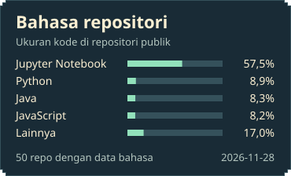

&#160;

<picture>
  <source media="(max-width: 640px)" srcset="assets/peta-minat-mobile.svg" width="400" height="464">
  
</picture>

Saya mahasiswa Teknik Informatika di Universitas Mataram. Saya suka membuat prototipe antarmuka web, memodelkan data untuk sistem informasi, dan mencoba AR untuk materi belajar.

[WhatsApp](https://wa.me/6281629632312) · [Instagram](https://www.instagram.com/alfath_mav/) · [amav1305@gmail.com](https://mail.google.com/mail/?view=cm&fs=1&to=amav1305%40gmail.com)

## Aktivitas GitHub

  
  

[Lihat kalender kontribusi](https://github.com/Mavianza#js-contribution-activity-description)
