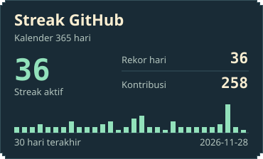

<picture>
  <source media="(max-width: 640px)" srcset="assets/peta-minat-mobile.svg" width="400" height="464">
  
</picture>

Saya mahasiswa Teknik Informatika di Universitas Mataram. Saya suka membuat prototipe antarmuka web, memodelkan data untuk sistem informasi, dan mencoba AR untuk materi belajar.

## Aktivitas GitHub

  
  

Streak memakai kalender kontribusi 365 hari terakhir. Komposisi bahasa dihitung dari ukuran kode di repo publik, dengan fork dan repo profil dikecualikan.

[Lihat kalender kontribusi](https://github.com/Mavianza?tab=overview#contribution-graph)
